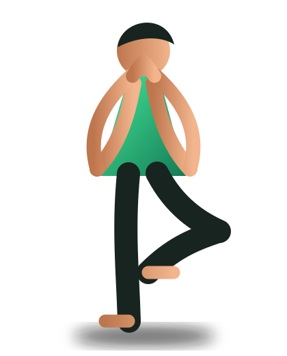

# 🧘 FitSense AI - Real-Time Vision AI Yoga Coach

FitSense AI is a full-stack, computer-vision powered yoga coach that analyzes your posture in real time, scores your stability, provides instant audio & visual corrections, and displays dynamic animated side guides so you can master every asana.



---

## ✨ Features

- **⚡ Ultra-Fast 60 FPS Camera Tracking**: 
  - Adaptive frame pipeline with sub-20ms MediaPipe Pose Landmarker detection.
  - Client-side 60 FPS linear interpolation (`lerp`) for silky-smooth holographic skeleton tracking.
  - Real-time joint angle readouts and HUD feedback.

- **👤 User Authentication & Personal History**:
  - Frictionless smart login and automatic account creation.
  - Persistent SQLite database tracking practice minutes, completed sessions, and form stability.
  - Personal avatars, personalized greetings, and session records.

- **🎨 Side Animated Visualizer ("Guess & Match the Pose")**:
  - Interactive SVG animated vector avatars demonstrating each posture side-by-side with your webcam feed.
  - Breathing aura animations and pulsing target alignment rings.
  - Real-time alignment checklists (turning green with checkmarks as you match each body part).
  - Catalog preview animations for all poses.

- **🔊 Multi-Language Voice Coaching**:
  - Audio coaching guidance in **English**, **हिंदी (Hindi)**, and **ગુજરાતી (Gujarati)**.
  - Web Audio celebration chimes on reaching hold duration goals.

---

## 🧘 Supported Poses

- **Tree Pose** (*Vrikshasana*) - Balance & focus
- **Mountain Pose** (*Tadasana*) - Foundation & posture alignment
- **Warrior II** (*Virabhadrasana II*) - Strength & 90° front knee lunge
- **Warrior I** (*Virabhadrasana I*) - High reach & square hips
- **Chair Pose** (*Utkatasana*) - Core & leg engagement
- **Plank Pose** (*Phalakasana*) - Straight line body stabilization
- **Cobra Pose** (*Bhujangasana*) - Heart opening backbend
- **Downward-Facing Dog** (*Adho Mukha Svanasana*) - Inverted V stretch
- **Triangle Pose** (*Trikonasana*) - Lateral flexibility & reach
- **Bridge Pose** (*Setu Bandhasana*) - Glutes & hip elevation
- **General Flow** - Full-body symmetry and posture verification

---

## 🚀 Quick Start

### 1. Prerequisites
- Python 3.10+ (tested with Python 3.13)
- Google Chrome or Microsoft Edge (for WebRTC webcam permissions)

### 2. Installation
```powershell
# Clone the repository
git clone https://github.com/aashiaryan6206-byte/fitsense_AI.git
cd fitsense_AI

# Create and activate virtual environment
python -m venv .venv
.\.venv\Scripts\activate

# Install required dependencies
pip install -r requirements.txt
```

### 3. Run the Application
```powershell
python app.py
```
Open **`http://127.0.0.1:5000`** in your browser.

---

## 📁 Project Architecture

```
fitsense-ai/
├── app.py                     # Flask backend & REST APIs
├── database.py                # SQLite user authentication & history storage
├── pose_engine.py             # Biomechanical joint angle assessment engine
├── pose_config.py             # Asana metadata, Sanskrit names, checkpoints
├── requirements.txt           # Python package dependencies
├── models/
│   └── pose_landmarker.task   # MediaPipe pretrained vision model
├── static/
│   ├── app.js                 # 60 FPS render loop & fast camera pipeline
│   ├── pose-visualizer.js     # Side animated SVG pose demonstrations
│   ├── style.css              # Obsidian & Emerald fitness UI theme
│   └── *.svg                  # Pose vector illustrations
└── templates/
    └── index.html             # Single-page web application UI
```

---

## 🔒 Privacy & Local Processing
FitSense AI runs camera stream processing locally on your machine. No video or camera recordings are saved or uploaded to external third-party servers.
